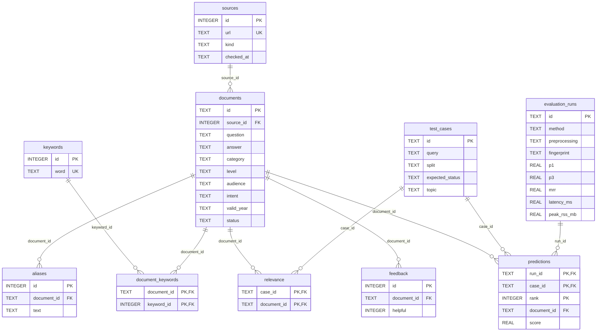

# ER-диаграмма SQLite

Всего 10 таблиц. Связи M:N: документы–ключевые слова и вопросы оценки–релевантные документы. Все подключения включают foreign_keys; повторный импорт обновляет записи по стабильным ID. История оценок дописывается с UUID, не заменяется. Текст пользовательской переписки в SQLite не записывается; feedback хранит только ID источника и оценку. `queries.sql` содержит 12 запросов с JOIN, GROUP BY/HAVING, CTE, подзапросами и оконными функциями; `tools/analyze.py` загружает их результаты в Pandas и CSV.
